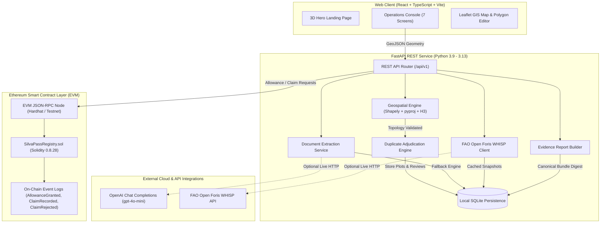

# SilvaPass

**"Every plot has an identity. Every claim has a limit."**

*An evidence-backed agricultural plot identity and shipment-integrity protocol developed for the IEEE ClimateChain Global Hackathon 2026.*

[](https://nodejs.org/)
[](https://www.python.org/)
[](https://soliditylang.org/)
[](https://hardhat.org/)
[](https://fastapi.tiangolo.com/)
[](https://react.dev/)
[](https://vite.dev/)
[](https://tailwindcss.com/)

SilvaPass connects off-chain geospatial plot boundary resolution with an on-chain shared production-claim invariant. It addresses two critical vulnerabilities in agricultural commodity supply chains: **boundary jitter laundering** (submitting slightly altered GPS polygon vertices to register the same land parcel multiple times) and **over-allocation double-claiming** (multiple exporters independently claiming consignments against the same physical harvest).

---

## 1. Project Header

```
   ┌────────────────────────────────────────────────────────────────────────┐
   │                              SILVAPASS                                 │
   │           Geospatial Plot Identity  ───►  EVM Invariant Ledger         │
   │           (Off-Chain Topological)         (On-Chain Mass-Balance)      │
   └────────────────────────────────────────────────────────────────────────┘
```

SilvaPass is an experimental climate-infrastructure prototype designed to provide auditable provenance and mass-balance integrity for agricultural parcels subject to deforestation-free regulations such as the European Union Deforestation Regulation (EUDR).

> [!NOTE]
> **Prototype Exploration**: SilvaPass is an academic and hackathon engineering prototype demonstrating verifiable land identity and shared accounting mechanisms. It is not an official EUDR compliance guarantee, an authorized TRACES-NT submission gateway, or a substitute for national cadastral title registries.

---

## 2. The Problem

Under emerging supply-chain due diligence frameworks, operators and traders must collect geographic coordinates of agricultural plots and demonstrate that consignments are legally produced and not sourced from deforested land after a specified cutoff date (e.g., December 31, 2020).

However, existing verification pipelines face two fundamental architectural vulnerabilities:

```
VULNERABILITY 1: BOUNDARY JITTER LAUNDERING (Geospatial)
   Original Polygon (30.0 ha)       Altered Polygon (GPS Jitter / Reordered Vertices)
   [ ─── Verified Plot ─── ]  ───►  [ - - - 3-5m Offset Jitter - - - ]
   Hash: 0x063ccdf1...              Hash: 0x9f4a812b... (Differs!)
   -> Naive exact SHA-256 coordinate hashing achieves only 25% recall,
      allowing malicious actors to register duplicate plots under separate IDs.

VULNERABILITY 2: THE DOUBLE-CLAIMING PROBLEM (Accounting)
   Approved Farm Harvest: 3,000 kg
   ├── Exporter A Claim:  1,800 kg  [Port of Santos -> Rotterdam]  (Remaining: 1,200 kg)
   └── Exporter B Claim:  2,000 kg  [Port of Paranaguá -> Hamburg] (Exceeds quota by 800 kg!)
   -> Without a shared, non-repudiable claim ledger, disconnected registries
      cannot prevent physical yield from being claimed multiple times.
```

1. **Geospatial Boundary Jitter & Coordinate Laundering**:
   Exact string or byte hashing of GeoJSON coordinate arrays fails when coordinates have minor GPS noise (3–5 meters), reversed vertex winding orders, or decimated intermediate points. In our synthetic benchmarks, naive exact hashing achieves only 25% recall against altered geometries representing the same parcel of land.

2. **The Disconnected Over-Allocation Problem**:
   When multiple traders purchase agricultural commodities from the same farming cooperatives, their due-diligence statements are often verified in silos. Without a shared, auditable state machine, Exporter A and Exporter B can both claim consignments totaling 3,800 kg against a physical farm that only produced 3,000 kg.

---

## 3. The Solution

SilvaPass establishes an integrated, evidence-backed protocol where **geospatial intelligence**, **AI document extraction**, and **smart contracts** operate with strict separation of responsibilities:

1. **Geospatial Matching Engine (Off-Chain)**:
   Topologically canonicalizes polygon boundaries (counter-clockwise exterior ring, normalized starting vertex), builds H3 spatial indices (resolutions 8 and 9), and computes spatial Intersection-over-Union (IoU), centroid drift, and Hausdorff distance using `pyproj` WGS84 geodesic math. Altered parcels matching existing plots above defined thresholds are flagged as duplicates and locked out of allowance issuance.

2. **Operator Adjudication Queue (Human-in-the-Loop)**:
   Rather than making brittle automated decisions on ambiguous overlaps (e.g., a 40% boundary overlap between neighboring holdings), the system places parcels into a `PENDING_REVIEW` queue requiring authorized supervisor adjudication with mandatory audit justifications.

3. **Shared Production-Claim Invariant (On-Chain)**:
   Enforces the fundamental mass-balance invariant on an EVM smart contract (`SilvaPassRegistry.sol`):
   $$\text{Net Accepted Claims} \le \text{Approved Production Allowance}$$
   $$\text{Remaining Allowance} = \text{Approved Allowance} - (\sum \text{Claims} - \sum \text{Releases}) \ge 0$$
   When an incoming shipment claim exceeds remaining capacity, the contract rejects the transaction without reverting storage, recording an immutable audit event while preserving the remaining quota balance.

4. **Cryptographic Proof Commitment**:
   Raw commercial invoices, farmer identities, and coordinate strings remain off-chain in private storage. Only cryptographically hashed commitments (bytes32 fingerprints and Merkle root digests) are recorded on-chain.

---

## 4. Features & Verification Matrix

The following table documents the implementation status and verification boundaries across all core protocol capabilities:

| Feature | Primary Purpose | Implementation Status | Verification & Limitations |
| :--- | :--- | :--- | :--- |
| **Plot Ingestion & Validation** | GeoJSON syntax, winding order, WGS84 boundary checks, geodesic area/perimeter | **Implemented & Tested** | Verified via `test_geospatial_engine.py` and Shapely topology checks. Lat $[-90, 90]$, Lon $[-180, 180]$. |
| **Near-Duplicate Detection** | Flags jittered, shifted, and rotated duplicate parcels | **Implemented & Tested** | Benchmarked against 15 synthetic test geometries ($F_1 = 1.000$ vs baseline exact hash $F_1 = 0.400$). Evaluated on synthetic fixtures. |
| **Ambiguous Review Queue** | Prevents blind auto-merges on partial overlaps | **Implemented & Tested** | Routes ambiguous overlaps ($20\% \le \text{IoU} < 85\%$) to `PENDING_REVIEW`. Requires supervisor justification. |
| **On-Chain Mass Balance** | Rejects claims exceeding approved capacity | **Implemented & Tested** | Verified in Solidity (`SilvaPassRegistry.sol`) with 14 automated Hardhat tests and 30-round randomized property tests. |
| **Claim Idempotency** | Prevents duplicate claim IDs from double-deducting | **Implemented & Tested** | Smart contract reverts on duplicate bytes32 claim ID with `ClaimAlreadyExists`. |
| **Human Document Confirmation** | Prevents AI extractions from directly mutating ledger | **Implemented & Tested** | Extractions enter `PENDING_CONFIRMATION`. Customs officer must sign off before claim submission. |
| **Document Extraction** | Parses Bills of Lading and phytosanitary certificates | **Implemented (Dual Mode)** | Tested with deterministic fallback ($97.3\%$ field accuracy). Live mode supports OpenAI `gpt-4o-mini` via HTTP. |
| **FAO WHISP Screening** | Multi-map deforestation risk relative to 2020 cutoff | **Implemented (Dual Mode)** | Verified offline with `CACHED_SNAPSHOT` fixtures; live HTTP integration implemented for `whisp.openforis.org`. |
| **Evidence Bundle Builder** | Canonical Merkle root digest for customs audits | **Implemented & Tested** | Deterministically anchors plot geometry, supervisor review, WHISP screening, and blockchain receipts. |
| **3D Real-Time Visualizer** | Interactive land-plot terrain & jitter demonstration | **Implemented & Tested** | Three.js interactive WebGL canvas on landing page with live phase animation. |
| **Public EVM Testnet Deployment** | Sepolia / Arbitrum Sepolia live network deployment | **Planned / Documented** | Contract currently verified and tested on local Hardhat EVM (Chain ID 31337). Public testnet deployment scripts prepared. |

---

## 5. Architecture



### Off-Chain vs. On-Chain Data Boundary

To safeguard commercial confidentiality and adhere to blockchain storage efficiency:

* **Stored Off-Chain (SQLite / Private Datastores)**:
  - Raw high-resolution coordinate vertices and GeoJSON geometries.
  - Farmer names, commercial invoices, and tax identifiers.
  - Raw text of Bills of Lading and phytosanitary certificates.
  - Full multi-raster environmental screening GeoTIFF / GeoJSON outputs.
* **Recorded On-Chain (`SilvaPassRegistry.sol`)**:
  - `bytes32 canonicalPlotHash`: SHA-256 digest of canonicalized geometry.
  - `uint256 approvedAllowanceKg`: Authorized seasonal harvest allowance.
  - `uint256 netClaimedKg`: Aggregate valid claims minus aggregate valid releases.
  - `bytes32 claimId`: Unique consignment identifier.
  - `bytes32 evidenceHash`: Merkle root digest of the verified evidence bundle.
  - OpenZeppelin `AccessControl` permissions (`REGISTRAR_ROLE`, `EXPORTER_ROLE`, `CLAIM_OPERATOR_ROLE`).

---

## 6. How the Protocol Works

```
      STEP 1                 STEP 2                 STEP 3                 STEP 4
 ┌───────────────┐      ┌───────────────┐      ┌───────────────┐      ┌───────────────┐
 │ Plot Ingest   │ ───► │ Near-Duplicate│ ───► │ On-Chain Quota│ ───► │ Consignment   │
 │ & Validation  │      │ Resolution    │      │ Grant (3000kg)│      │ Claims (EVM)  │
 └───────────────┘      └───────────────┘      └───────────────┘      └───────────────┘
                                                                             │
                      ┌──────────────────────────────────────────────────────┴────────┐
                      ▼                                                               ▼
             Claim 1: 1,800 kg                                              Claim 2: 2,000 kg
             Remaining: 1,200 kg                                            Exceeds Capacity by 800 kg!
             Status: CONFIRMED                                              Status: REJECTED_OVER_ALLOCATION
             (Balance deducted)                                             (Balance preserved at 1,200 kg)
```

1. **Plot Ingestion & Canonicalization**:
   The producer submits a boundary polygon. SilvaPass validates that the geometry is closed, non-self-intersecting, and within valid WGS84 bounds. Coordinates are normalized to counter-clockwise winding.

2. **Deduplication Check**:
   The spatial engine matches candidate H3 hexagons against existing records. If spatial IoU exceeds 85% and centroid drift is under 25 meters, the plot is assigned `FLAGGED_DUPLICATE`. If overlap is partial (20–85%), it enters `PENDING_REVIEW` for operator adjudication.

3. **Environmental Screening**:
   The plot is screened against FAO Open Foris WHISP multi-dataset deforestation baselines relative to December 31, 2020. Results are tagged with honest provenance: `EXTERNAL_VERIFIED`, `CACHED_SNAPSHOT`, or `UNRESOLVED_UNCERTAINTY`.

4. **Production Quota Grant (Illustrative Example: 3,000 kg)**:
   An authorized registrar grants an approved allowance of **3,000 kg** of soybeans for the 2026 season. The transaction is mined on `SilvaPassRegistry.sol`.

5. **First Shipment Claim (1,800 kg)**:
   Exporter A extracts shipment consignment data from a Bill of Lading, confirms the fields, and submits `CLAIM-01` for **1,800 kg**. The smart contract verifies that $1,800 \le 3,000$, deducts the capacity, and emits `ShipmentClaimAccepted`. The remaining allowance is exactly **1,200 kg**.

6. **Over-Allocation Rejection (2,000 kg)**:
   Exporter B attempts to submit `CLAIM-02` for **2,000 kg** against the same plot. Because $2,000 > 1,200$, the transaction violates the invariant. The contract non-revertably rejects the claim with status `REJECTED_OVER_ALLOCATION`, emits `ShipmentClaimRejected`, and **strictly preserves the remaining balance at 1,200 kg**.

7. **Root Evidence Bundle Packaging**:
   Customs inspectors generate a consolidated evidence package containing plot geometry, supervisor review justification, WHISP risk observations, and blockchain transaction receipts, anchored under a deterministic Merkle root hash.

---

## 7. Technology Stack

### Frontend Client
- **React 19.2** & **TypeScript 6.0**: Modern typed component hierarchy.
- **Vite 8.3**: Optimized ES module build pipeline.
- **Tailwind CSS v4**: Natural palette design system (`#07130F` forest background, `#B7ED78` accent).
- **Three.js 0.186**: Custom 3D WebGL interactive land terrain and jitter boundary simulation.
- **Leaflet 1.9**: Interactive GIS mapping, dynamic bounds fitting, and GeoJSON overlay rendering.
- **Lucide React**: Climate and operational interface iconography.

### Backend REST API
- **Python 3.9 - 3.13** (Tested on Python 3.13.15 LTS): Asynchronous backend execution.
- **FastAPI 0.128** & **Starlette**: High-performance REST interface with OpenAPI Swagger specs.
- **Pydantic v2**: Strict input validation and sanitization schemas.
- **Shapely 2.0.7**: 2D geospatial geometry operations and topological predicates.
- **pyproj 3.6.1**: WGS84 geodesic distance and ellipsoidal area computations.
- **Uber H3 (h3-py 4.4)**: Hexagonal hierarchical spatial indexing.
- **SQLAlchemy 2.0** & **SQLite3**: ACID-compliant local metadata and audit persistence.
- **Web3.py 7.16**: Ethereum JSON-RPC client interface.
- **HTTPX 0.28**: Asynchronous HTTP client with connection pooling and timeouts.

### Smart Contracts
- **Solidity 0.8.28**: Smart contract implementation with 200-run optimizer.
- **Hardhat 2.22.19**: Ethereum compilation, local EVM node simulation, and testing harness.
- **OpenZeppelin Contracts 5.2.0**: Battle-tested `AccessControl` and security primitives.

### External Integrations (Optional)
- **FAO Open Foris WHISP**: Global multi-map deforestation screening API (`https://whisp.openforis.org/api`).
- **OpenAI API**: Chat Completions (`gpt-4o-mini`) for consignment document extraction.

---

## 8. Repository Structure

```
silvapass/
├── backend/                       # FastAPI REST API service
│   ├── api/                       # Versioned API routes (v1_router.py)
│   ├── contracts_client/          # Web3.py client & policy boundary enforcement
│   ├── documents/                 # Bill of Lading extraction & prompt injection defense
│   ├── environmental/             # FAO Open Foris WHISP client & snapshot cache
│   ├── evidence/                  # Canonical Merkle evidence bundle generator
│   ├── geo/                       # Shapely canonicalization, validator, and H3 matcher
│   ├── schemas/                   # Pydantic request and response schemas
│   ├── storage/                   # SQLite database manager & spatial index
│   ├── tests/                     # Pytest suite (API, boundary, geo, WHISP, e2e)
│   ├── config.py                  # Pydantic Settings environment configuration
│   ├── main.py                    # Application entry point & lifespan handler
│   └── requirements.txt           # Pinned Python package dependencies
├── contracts/                     # Solidity smart contract workspace
│   ├── contracts/                 # SilvaPassRegistry.sol
│   ├── scripts/                   # Local deployment script (deploy.ts)
│   ├── test/                      # Hardhat test suite & randomized property tests
│   └── hardhat.config.ts          # Compiler & network configuration
├── data/demo/                     # Reference benchmarks & synthetic test fixtures
│   └── synthetic_plots/           # GeoJSON test cases (shifts, rotations, jitter)
├── docs/                          # Formal engineering documentation & ADRs
│   ├── ARCHITECTURE.md            # Deep-dive system architecture specification
│   ├── DEMO_SCRIPT.md             # Timed 4-minute hackathon pitch & demo script
│   ├── DEPLOYMENT.md              # Cloud deployment guide (Vercel, Netlify, Render, Railway)
│   ├── EVALUATION_METHODOLOGY.md  # 4-track empirical evaluation methodology
│   ├── REQUIREMENTS.md            # Functional & non-functional requirements
│   └── THREAT_MODEL.md            # STRIDE threat assessment & mitigation policies
├── frontend/                      # React + TypeScript + Vite web client
│   ├── src/
│   │   ├── api/                   # Typed backend REST client
│   │   ├── components/            # ConsoleShell, Leaflet MapViewer, ErrorBoundary
│   │   ├── landing/               # Three.js Hero3DScene, Interactive Simulator
│   │   ├── screens/               # 7 Operations Console screen components
│   │   └── types/                 # Shared TypeScript models
│   ├── package.json               # Frontend dependencies & scripts
│   └── vite.config.ts             # Vite bundler & Vitest configuration
├── scripts/                       # Local developer automation
│   ├── run_evaluation_suite.py    # 4-part offline reproducible evaluation harness
│   └── seed_demo_scenario.py      # Deterministic 10-step demo fixture seeder
├── .env.example                   # Sanitized configuration template
├── .gitignore                     # Git exclusion rules (secrets, DBs, node_modules)
├── evaluation_results.json        # Machine-readable output from latest evaluation run
├── package.json                   # Root developer command interface
└── silvapass.db                   # Local development SQLite database (ignored by git)
```

---

## 9. Prerequisites

Before installing SilvaPass, verify that your local environment meets these requirements:

| Component | Minimum Version | Verified Active Version | Notes |
| :--- | :--- | :--- | :--- |
| **Node.js** | `v20.0.0` or `v22.0.0` | `v22.23.1 LTS` | Runtime for frontend and Hardhat |
| **npm** | `v10.0.0+` | `10.9.8` | Package manager (**never use `bun`**) |
| **Python** | `3.9+` | `3.13.15` | Backend runtime |
| **Git** | `2.30+` | Installed | Version control |
| **Docker** | *Not required* | — | Protocol runs bare-metal for fast setup |

### Optional Service Prerequisites:
* **FAO WHISP Screening**: Requires an account at [https://whisp.openforis.org](https://whisp.openforis.org) to obtain an API key for `WHISP_MODE=LIVE`. Operates fully offline in `SNAPSHOT` mode without credentials.
* **OpenAI Document Extraction**: Requires an OpenAI API key for `EXTRACTION_MODE=LIVE`. Operates fully offline using `RuleBasedExtractionProvider` without credentials.
* **Public EVM Testnet**: Requires a funded private key and RPC provider (e.g., Alchemy / Infura) to deploy to public testnets. Operates locally on the bundled Hardhat EVM node.

---

## 10. Installation and Local Development

Follow this step-by-step walkthrough to clone, configure, and launch the complete stack.

### Step 1: Clone the Repository & Configure Environment

**Windows PowerShell**:
```powershell
git clone https://github.com/Akulbanxal/SilvaPass.git
Set-Location SilvaPass
Copy-Item .env.example .env
```

*(macOS / Linux alternative)*:
```bash
git clone https://github.com/Akulbanxal/SilvaPass.git
cd SilvaPass
cp .env.example .env
```

---

### Step 2: Set Up Python Backend Virtual Environment

**Windows PowerShell**:
```powershell
python -m venv .venv
.\.venv\Scripts\Activate.ps1
python -m pip install --upgrade pip
pip install -r backend/requirements.txt
```

*(macOS / Linux alternative)*:
```bash
python3 -m venv .venv
source .venv/bin/activate
pip install --upgrade pip
pip install -r backend/requirements.txt
```

---

### Step 3: Install Smart Contract & Frontend Dependencies

**Windows PowerShell / macOS / Linux**:
```bash
# Install smart contract dependencies
npm run --prefix contracts install

# Install frontend dependencies
npm run --prefix frontend install
```

---

### Step 4: Launch the Local Development Services

SilvaPass operates with three lightweight local services. Open three separate terminal windows:

#### Terminal 1: Smart Contract Node (Hardhat EVM)
```bash
# In repository root
npm run node:contracts
# Starts local JSON-RPC at http://127.0.0.1:8545 (Chain ID: 31337)
```

#### Terminal 2: Deploy Contract & Start Backend API (FastAPI)
```powershell
# Deploy contract locally (run once while node is up)
npx --prefix contracts hardhat run scripts/deploy.ts --network localhost

# Start backend service (Windows PowerShell)
.\.venv\Scripts\Activate.ps1
python -m uvicorn backend.main:app --host 127.0.0.1 --port 8080 --reload
```

#### Terminal 3: Start Frontend Client (Vite Dev Server)
```bash
# In repository root
npm run start:frontend
# Client starts at http://localhost:5173
```

Navigate to **`http://localhost:5173`** in your browser.

---

## 11. Environment Configuration

All application configuration is loaded via environment variables managed through `.env`. 

> [!CAUTION]
> **Secret Hygiene**: Real private keys and API tokens must **never** be committed to version control. The repository `.gitignore` automatically excludes `.env` and `*.key` files.

### Configuration Variables Reference Table

| Variable Name | Purpose | Default Value | Cloud / Production | Status |
| :--- | :--- | :--- | :--- | :--- |
| `ENVIRONMENT` | Runtime mode (`development` or `production`) | `development` | `production` | Optional |
| `LOG_LEVEL` | Logging verbosity (`DEBUG`, `INFO`, `WARNING`, `ERROR`) | `INFO` | `INFO` | Optional |
| `BACKEND_HOST` | Host interface for uvicorn | `127.0.0.1` | `0.0.0.0` | Optional |
| `BACKEND_PORT` | Port for FastAPI REST API | `8080` | `8080` (or `$PORT`) | Optional |
| `ALLOWED_ORIGINS` | Comma-separated CORS allowed domains | `http://localhost:5173,...` | `https://silva-pass.vercel.app` | Required in prod |
| `DATABASE_URL` | SQLite database file URI | `sqlite:///./silvapass.db` | Persistent volume path | Required |
| `EVM_RPC_URL` | Blockchain JSON-RPC endpoint | `http://127.0.0.1:8545` | Public EVM RPC URL | Required |
| `CHAIN_ID` | Blockchain network chain ID | `31337` | `11155111` (Sepolia) | Required |
| `REGISTRAR_PRIVATE_KEY` | Private key for signing allowance transactions | *Hardhat Account #0* | `[SECRET KEY]` | Required |
| `SILVAPASS_REGISTRY_ADDRESS` | Address of deployed `SilvaPassRegistry.sol` | *Populated upon deploy* | `0x...` | Required |
| `WHISP_MODE` | Environmental screening mode (`LIVE`, `SNAPSHOT`, `SIMULATION`) | `SNAPSHOT` | `LIVE` or `SNAPSHOT` | Optional |
| `WHISP_API_URL` | FAO Open Foris WHISP API endpoint | `https://whisp.openforis.org/api` | `https://whisp.openforis.org/api` | Optional |
| `WHISP_API_KEY` | FAO WHISP API authentication key | `""` | `[SECRET TOKEN]` | Optional (Live only) |
| `EXTRACTION_MODE` | AI document extraction mode (`MOCK` or `LIVE`) | `MOCK` | `LIVE` or `MOCK` | Optional |
| `LLM_PROVIDER` | LLM service provider | `openai` | `openai` | Optional |
| `LLM_MODEL` | LLM model identifier | `gpt-4o-mini` | `gpt-4o-mini` | Optional |
| `OPENAI_API_KEY` | OpenAI secret API key | `""` | `[SECRET KEY]` | Optional (Live only) |
| `VITE_BACKEND_API_URL` | Frontend REST API base URL | `http://127.0.0.1:8080` | `https://your-backend.onrender.com` | Required (Frontend) |

---

## 12. Configuration of External Services

### 1. FAO Open Foris WHISP Screening

SilvaPass integrates with **FAO Open Foris WHISP** (*"What is in that plot?"*) to perform multi-map convergence-of-evidence deforestation risk screenings relative to the December 31, 2020 cutoff date.

* **Documentation & Registration**: Register at [https://whisp.openforis.org](https://whisp.openforis.org) to obtain an API key.
* **Modes Supported**:
  - `SNAPSHOT` (*Default*): Deterministic, offline reference benchmarks (e.g. Mato Grosso Soy baseline). No network calls or API keys required.
  - `LIVE`: Sends authenticated asynchronous requests (`POST https://whisp.openforis.org/api/submit/geojson`) using header `X-API-KEY`. Automatically polls for job completion.
  - `SIMULATION`: Explicit offline mathematical calculation for automated test suites.
* **Fault Handling**: Rate-limits (HTTP 429), timeouts, or credential failures return explicit `UNRESOLVED_UNCERTAINTY` provenance tags rather than fabricating verified observations.

### 2. OpenAI Document Extraction

SilvaPass includes an AI document extraction pipeline to parse unstructured Bills of Lading and phytosanitary certificates into structured consignment records.

* **Implementation**: Uses `httpx.AsyncClient` to dispatch requests directly to `POST https://api.openai.com/v1/chat/completions` using model `gpt-4o-mini`.
* **Credential Configuration**: Set `EXTRACTION_MODE=LIVE` and `OPENAI_API_KEY=sk-...` in `.env`.
* **Deterministic Fallback**: If `EXTRACTION_MODE=MOCK`, or if an API quota is exhausted (HTTP 429), the backend automatically and transparently falls back to `RuleBasedExtractionProvider` with an audited warning.
* **Human Confirmation Gate**: All extracted fields remain in `PENDING_CONFIRMATION` status until an authorized customs officer signs off.

---

## 13. Running Tests & Empirical Verification

SilvaPass maintains an extensive test suite across smart contracts, geospatial geometry, API endpoints, and fault tolerance.

### 1. Execute All Test Suites
```bash
# Run contracts, backend, and frontend tests
npm test
```

### 2. Individual Test Runners
```bash
# Smart Contract Tests (14 passing tests, invariant checks, access control)
npm run test:contracts

# Backend Unit & Integration Tests (Pytest)
npm run test:backend

# Frontend Unit Tests (Vitest)
npm run test:frontend

# Production TypeScript Build Validation
npm run build:frontend
```

### 3. Unified Reproducible Evaluation Suite
To execute the comprehensive 4-track empirical evaluation and generate `evaluation_results.json`:
```bash
npm run evaluate
```

#### Actual Recorded Evaluation Results (`evaluation_results.json`):
* **Evaluation A (Plot Identity Resolution)**:
  - Synthetic test cases: 15 (8 duplicates, 7 distinct/invalid)
  - Baseline 1 (Exact Hash): Precision 1.000, Recall 0.250, $F_1 = 0.400$
  - Baseline 2 (Centroid $<25$m): Precision 0.889, Recall 1.000, $F_1 = 0.941$ (1 false positive)
  - **Proposed SilvaPass Engine**: Precision 1.000, Recall 1.000, $F_1 = 1.000$
* **Evaluation B (Smart Contract Invariants)**:
  - 14/14 tests passing. Verified mass balance, non-negative capacity, claim idempotency, non-reverting rejection, and 30-round randomized property test.
* **Evaluation C (Document Extraction)**:
  - 97.3% field extraction accuracy across evaluated consignment documents.
  - 100% missing plot detection rate.
  - 100% prompt injection defense rate.
* **Evaluation D (Fault Handling & Boundary Defense)**:
  - 10/10 fault scenarios verified (timeouts, 502 malformed responses, rate-limit backoff, boundary denials).
* **Overall Verdict**: **`PASSED (Core Architectural Claims Supported)`**.

---

## 14. Demo Walkthrough

SilvaPass includes a one-command deterministic seeder to initialize the complete hackathon scenario.

### Step 0: Seed the Clean Demo Scenario
```bash
npm run seed:demo:reset
```

Open `http://localhost:5173` and follow this 10-step verification flow:

1. **Inspect Registered Base Plot**: Open **Tab 2 (Plot Registry)**. Observe `PLOT-BASE-DEMO` (~30 hectares in Mato Grosso, Brazil) highlighted on the satellite map in `ACTIVE` status.
2. **Submit Perturbed Polygon (Jitter)**: In the Plot Registry, click **"Load Jittered Duplicate Plot"** (incorporates 3–5m GPS noise). Click **Validate Geometry**, then **Register Plot**. Notice the system detects 99.25% spatial IoU and flags it as `FLAGGED_DUPLICATE`.
3. **Inspect Ambiguous Overlap**: Open **Tab 3 (Duplicate Review)**. Inspect `PLOT-AMB-DEMO` which has a 40% boundary overlap. Notice it is held in `PENDING_REVIEW` rather than automatically merged.
4. **Adjudicate Ambiguous Parcel**: Review the side-by-side polygon visualizer. Enter an audit justification as supervisor `OP-SUPERVISOR-42` and adjudicate the parcel to `ACTIVE`.
5. **Inspect On-Chain Allowance**: Open **Tab 4 (Claim Ledger)**. Verify that `PLOT-BASE-DEMO` has an approved production allowance of **3,000 kg** on the connected Hardhat EVM contract (`Chain ID: 31337`).
6. **Submit Valid Shipment Claim (1,800 kg)**: Review Claim 1 (`CLAIM-BOL-DEMO-01`) for **1,800 kg**. Status is `CONFIRMED`, and remaining capacity is exactly **1,200 kg**.
7. **Attempt Over-Allocation Claim (2,000 kg)**: In the Claim Ledger form, submit a new claim for **2,000 kg** against `PLOT-BASE-DEMO`. Observe that the transaction emits status `REJECTED_OVER_ALLOCATION` and the remaining balance remains **strictly preserved at 1,200 kg**.
8. **Extract Consignment Document**: Open **Tab 5 (Document Extraction)**. Load `bol_demo_1800kg.txt` and click **Extract Consignment Data**. Notice fields are parsed (Commodity: `SOY`, Net: `1,800 KG`) and held at `PENDING_CONFIRMATION`.
9. **Confirm Fields as Customs Officer**: Click **Confirm Fields**. Verify that AI models cannot mutate ledger balances autonomously without human confirmation.
10. **Review Evidence Bundle & WHISP Screening**: Open **Tab 6 (WHISP Screening)** to view the `LOW_RISK` assessment with `CACHED_SNAPSHOT` provenance. Open **Tab 7 (Evidence Report)** to view the final Merkle root digest binding geometry, supervisor review, and blockchain receipts.

---

## 15. Security, Boundaries, and Limitations

To maintain uncompromising engineering honesty, operators and evaluators must understand the technical boundaries of the protocol:

1. **Hashes Do Not Prove Physical Truth**:
   Anchoring a cryptographic hash of a land parcel or Bill of Lading on-chain proves *data integrity and timestamp immutability*—it does not prove that the underlying land title was legally granted or that the physical truck contained pure commodity without off-system substitution.

2. **Cadastral Authority Dependency**:
   SilvaPass detects coordinate laundering and near-duplicate geometries among submitted parcels. It does not replace national land tenure registries or ground-truth land surveyors.

3. **Geospatial False Positives**:
   Spatial deduplication relies on geometric overlap thresholds (IoU and centroid drift). Intentionally fragmented farming parcels or legitimate neighboring subdivisions require human review via the `DuplicateReviewQueue` to prevent false-positive merges.

4. **Environmental Screening Boundaries**:
   FAO WHISP screenings provide multi-map convergence-of-evidence indicators relative to the 2020 cutoff date. They represent remote-sensing observations and do not constitute legal determinations of deforestation or certified compliance.

5. **Local Network Demonstration**:
   Transactions executed in the default local demonstration environment run on a local Hardhat EVM node (`Chain ID: 31337`). While identical in EVM bytecode execution to Ethereum mainnet, they do not involve real cryptocurrency or live gas costs.

6. **Regulatory Disclaimer**:
   SilvaPass is an independent engineering exploration. It is not an officially endorsed EUDR compliance platform, an accredited certification body, or an authorized TRACES-NT submission gateway.

---

## 16. Roadmap

Future development directions beyond the hackathon prototype include:

* [ ] **Public EVM Testnet Deployment**: Deploy and verify `SilvaPassRegistry.sol` on Arbitrum Sepolia and Ethereum Sepolia with automated block explorer verification.
* [ ] **Zero-Knowledge Geometry Commitments**: Investigate Circom / snarkjs circuits to prove a parcel is within a legal cadastral boundary without publicly disclosing private farm coordinates.
* [ ] **Multi-Crop Allowance Modeling**: Expand from single-season scalar allowances to dynamic multi-harvest yield curves based on historical agrometeorological models.
* [ ] **Decentralized Identifier (DID) Integration**: Support W3C Verifiable Credentials for authorized agronomists and accredited customs officers.
* [ ] **Physical Mass-Balance Token Gateways**: Interfacing on-chain allowance balances with ERC-3643 compliant permissioned asset tokens for trade finance integration.

---

## 17. Screenshots & Demo Media

The repository includes pre-built visual and demonstration assets:

* **3D Landing Page Terrain & Invariant Visualizer**: [frontend/src/assets/hero.png](frontend/src/assets/hero.png)
* **Timed Video Demonstration Script**: Complete scene-by-scene script with timestamps and voiceover available in [`docs/DEMO_SCRIPT.md`](docs/DEMO_SCRIPT.md).
* **Cloud Deployment Guide**: Step-by-step instructions for deploying to Vercel and Render available in [`docs/DEPLOYMENT.md`](docs/DEPLOYMENT.md).

*(To capture new screenshots of the 7 operations screens, launch the app locally and navigate to `#overview`, `#plots`, `#reviews`, `#ledger`, `#documents`, `#environmental`, and `#evidence`.)*

---

## 18. Hackathon Context & Disclaimer

* **Competition**: Developed for the **IEEE ClimateChain Global Hackathon 2026**.
* **Track**: Climate Infrastructure, Agricultural Integrity, and Sustainable Supply Chains.
* **Disclaimer**: This software is provided as-is as an engineering proof-of-concept under the terms of the hackathon submission. No commercial guarantees or warranties of regulatory adherence are implied.

---

## 19. Contributing & License

### Contributing
Contributions, issue reports, and security vulnerability disclosures are welcome:
1. Fork the repository.
2. Create a feature branch (`git checkout -b feature/improved-h3-indexing`).
3. Ensure all tests pass (`npm test` and `npm run evaluate`).
4. Commit your changes with descriptive messages.
5. Open a Pull Request against `main`.

### License
This repository is currently maintained as an open-source hackathon prototype. Refer to the repository root for licensing updates or contact the maintainers for commercial licensing inquiries.

---

## 20. Acknowledgements & References

The SilvaPass architecture builds upon official research, standards, and open-source tooling:

* **FAO Open Foris WHISP**: *"What is in that plot?"* Multi-map deforestation risk screening platform. [https://whisp.openforis.org](https://whisp.openforis.org)
* **European Union Deforestation Regulation (EUDR)**: Regulation (EU) 2023/1115 on deforestation-free products. [Official Journal of the European Union](https://eur-lex.europa.eu/eli/reg/2023/1115/oj)
* **Uber H3**: Hexagonal Hierarchical Spatial Index. [https://h3geo.org](https://h3geo.org)
* **Shapely & GEOS**: Planar geometric algorithms. [https://shapely.readthedocs.io](https://shapely.readthedocs.io)
* **OpenZeppelin Contracts**: Modular, secure smart contract library. [https://openzeppelin.com/contracts](https://openzeppelin.com/contracts)
* **FastAPI**: Modern, fast web framework for building APIs with Python. [https://fastapi.tiangolo.com](https://fastapi.tiangolo.com)
* **Ethereum & Hardhat**: EVM development environment. [https://hardhat.org](https://hardhat.org)
