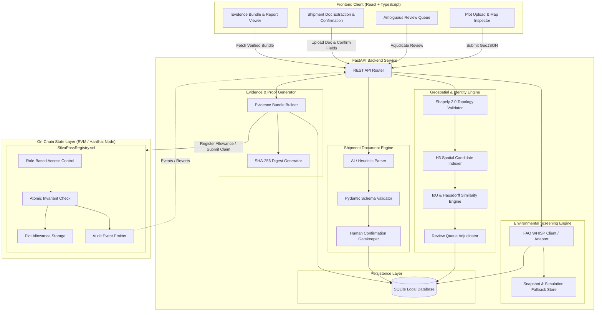
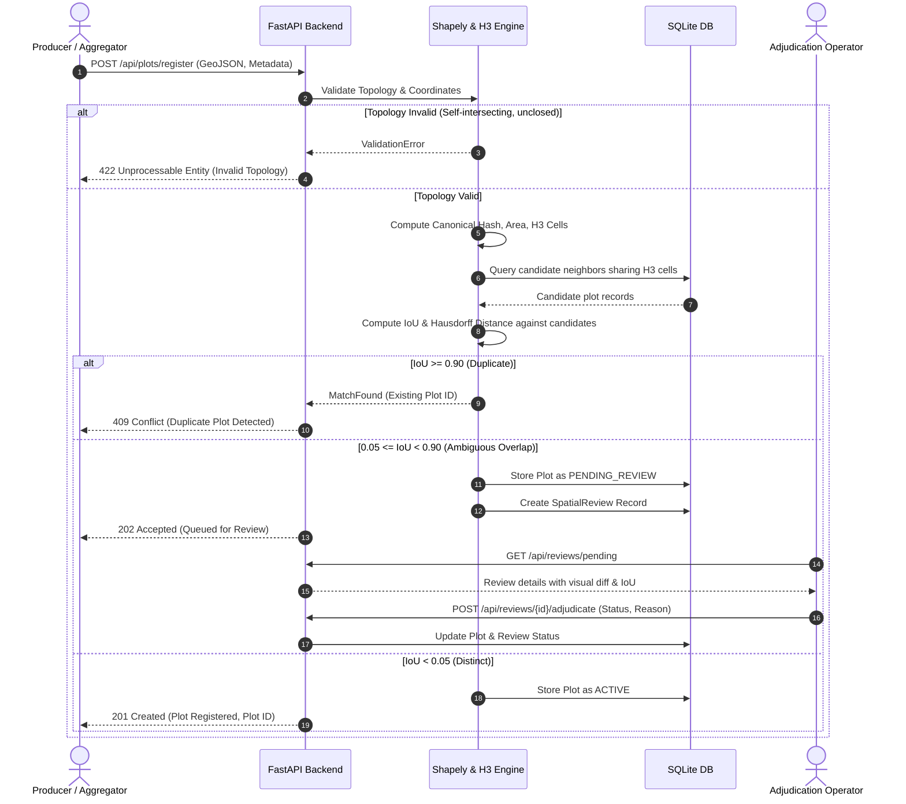
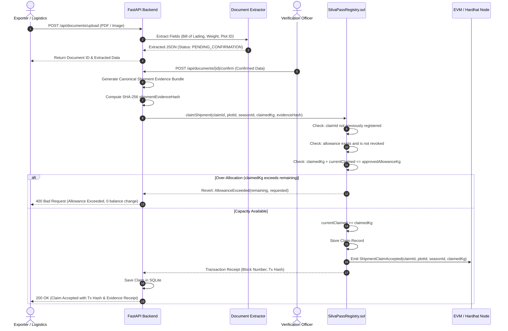

# SilvaPass Architecture Specification

**Document Version:** 1.0.0  
**Technology Stack:** React + TypeScript (Frontend), Python FastAPI (Backend), Shapely + H3 (Geospatial), Solidity + OpenZeppelin (Blockchain), SQLite (Local Persistence).

---

## 1. System Architecture Overview

SilvaPass implements an off-chain/on-chain hybrid architecture. Geospatial validation, deduplication analysis, environmental screening, and document processing execute off-chain where complex computation and private data reside. The blockchain is strictly reserved as an auditable, neutral coordination layer enforcing the production allowance and claim invariant across mutually distrusting supply chain actors.



---

## 2. Component Specifications & Boundaries

### 2.1 Frontend Client (React + TypeScript)
- **Role**: Presentation and human-in-the-loop interaction layer.
- **Key Modules**:
  - `PlotVisualizer`: Map component (Leaflet) rendering submitted boundaries, neighbor boundaries, and bounding envelopes.
  - `ReviewAdjudicator`: Side-by-side polygon diff viewer showing IoU scores, centroid drift, and input form for required operator justifications.
  - `DocumentConfirmModal`: Two-column display rendering the original document text alongside structured extracted fields, highlighting low-confidence fields for mandatory human review.
  - `EvidenceReportViewer`: Detailed transparency view displaying each evidence claim along with its cryptographic hash and provenance badge (`[MEASURED]`, `[EXTERNAL_VERIFIED]`, etc.).
- **Boundary Rule**: The client never directly calls the Ethereum RPC or signs blockchain transactions; all transactions route through the FastAPI backend gateway to preserve signature auditability and coordinate commitments off-chain.

### 2.2 FastAPI Backend Service (Python 3.9+)
- **Role**: Orchestration, validation, data transformation, and off-chain persistence.
- **Key Modules**:
  - `core/`: Application settings (`pydantic-settings`), custom exception handlers, database session management, structured logging.
  - `geo/`:
    - `validator.py`: Shapely 2.0 topology verification (validity, simple polygon, ring closure, bounds, geodesic area via `pyproj`).
    - `indexer.py`: H3 spatial indexing (`h3-py`). Computes resolution 8 and 10 cells covering the polygon envelope to prune similarity candidates.
    - `matcher.py`: Shapely exact geometric comparisons (IoU calculation, Hausdorff distance, centroid drift, orientation checks).
    - `review.py`: State machine for flagging, holding, and adjudicating ambiguous plots.
  - `environmental/`:
    - `whisp_client.py`: Client for FAO WHISP API (`POST /submit/geojson`, `GET /status/{token}`) with `X-API-KEY`.
    - `fallback_provider.py`: Deterministic snapshot replays and mock fixtures when external network or keys are absent.
  - `documents/`:
    - `extractor.py`: Structured field extraction from raw documents (text or OCR) using schema-enforced prompt contracts or regex fallbacks.
    - `confirmation.py`: Human-in-the-loop workflow requiring operator sign-off before claim issuance.
  - `blockchain/`:
    - `client.py`: Web3.py wrapper interacting with `SilvaPassRegistry.sol` deployed on the local Hardhat node.
  - `evidence/`:
    - `report.py`: Aggregates plot geometry hash, WHISP screening digest, document hash, confirmation log, and on-chain tx receipt into a canonical JSON-LD / JSON schema and computes the root SHA-256 digest.

### 2.3 Off-Chain Persistence (SQLite)
- **Role**: Local fast-query storage for raw GeoJSON geometries, document archives, spatial indexes, operator review logs, and cached screening snapshots.
- **Tables**:
  - `plots`: `id`, `canonical_hash`, `boundary_wkt`, `area_ha`, `h3_res8`, `status`, `created_at`.
  - `spatial_reviews`: `id`, `submitted_plot_id`, `conflicting_plot_id`, `iou`, `hausdorff_m`, `status`, `operator_notes`, `adjudicated_at`.
  - `allowances`: `id`, `plot_id`, `season_id`, `crop_code`, `approved_kg`, `evidence_hash`, `status`.
  - `shipment_documents`: `id`, `file_hash`, `raw_text`, `extracted_json`, `confirmed_json`, `status`, `operator_id`.
  - `claims`: `id`, `claim_id_hex`, `plot_id`, `season_id`, `claimed_kg`, `tx_hash`, `status`, `created_at`.
  - `whisp_screenings`: `id`, `plot_id`, `risk_category`, `provenance`, `raw_response_digest`, `created_at`.

### 2.4 On-Chain Invariant Anchor (`SilvaPassRegistry.sol`)
- **Role**: Canonical, tamper-proof state layer enforcing the shared claim balance across mutually distrusting parties.
- **Contract Framework**: OpenZeppelin Contracts v5.x (`AccessControlUpgradeable` or standard `AccessControl`, `ReentrancyGuard`, `Pausable`).
- **Core State**:
  ```solidity
  struct Allowance {
      bytes32 plotId;
      uint256 seasonId;
      bytes32 cropCode;
      uint256 approvedAllowanceKg;
      uint256 claimedKg;
      bytes32 allowanceEvidenceHash;
      bool isRevoked;
  }
  
  struct Claim {
      bytes32 plotId;
      uint256 seasonId;
      uint256 claimedKg;
      bytes32 shipmentEvidenceHash;
      bool isReleased;
      address claimant;
      uint256 timestamp;
  }
  ```
- **Guaranteed Invariants**:
  1. `claimedKg <= approvedAllowanceKg` at all times.
  2. Double-claim prevention: Any `claimId` used once cannot be re-used.
  3. Atomic reversion on insufficient allowance capacity.
  4. Allowance reduction or revocation cannot retroactively invalidate already accepted claims without explicit administrative release.

---

## 3. Detailed Data Flows & Sequence Diagrams

### 3.1 Plot Registration & Ambiguity Review Flow


### 3.2 Shipment Claim Lifecycle & On-Chain Invariant Enforcement


---

## 4. API Contracts (FastAPI REST Specification)

### 4.1 Plot Endpoints
- `POST /api/plots/validate`:
  - Request: `{ "geojson": { "type": "Feature", "geometry": ... }, "crs": "EPSG:4326" }`
  - Response: `{ "is_valid": true, "area_ha": 14.25, "perimeter_m": 1640.2, "errors": [] }`
- `POST /api/plots/register`:
  - Request: `{ "geojson": ..., "country_code": "BR", "crop_type": "SOY" }`
  - Response: `{ "plot_id": "uuid", "canonical_hash": "0x...", "status": "ACTIVE" | "PENDING_REVIEW" }`
- `GET /api/plots/{plot_id}`:
  - Returns complete plot metadata, canonical hash, and associated allowance status.

### 4.2 Spatial Review Endpoints
- `GET /api/reviews/pending`:
  - Returns list of open spatial conflicts requiring human adjudication.
- `POST /api/reviews/{review_id}/adjudicate`:
  - Request: `{ "action": "CONFIRM_DUPLICATE" | "APPROVE_SEPARATE_PARCEL", "justification": "Operator inspected survey marker..." }`
  - Response: `{ "review_id": "uuid", "status": "ADJUDICATED", "timestamp": "..." }`

### 4.3 Allowance & On-Chain Endpoints
- `POST /api/allowances/grant`:
  - Request: `{ "plot_id": "uuid", "season_id": 2026, "crop_code": "COFFEE", "approved_kg": 50000, "evidence_document_hash": "0x..." }`
  - Response: `{ "allowance_id": "uuid", "tx_hash": "0x...", "status": "CONFIRMED_ON_CHAIN" }`
- `POST /api/claims/submit`:
  - Request: `{ "document_id": "uuid", "plot_id": "uuid", "season_id": 2026, "claimed_kg": 12500 }`
  - Response: `{ "claim_id": "0x...", "status": "ACCEPTED", "remaining_capacity_kg": 37500, "tx_hash": "0x..." }`
- `POST /api/claims/{claim_id}/release`:
  - Request: `{ "reason": "Shipment cancelled at port of departure" }`
  - Response: `{ "claim_id": "0x...", "status": "RELEASED", "restored_kg": 12500, "tx_hash": "0x..." }`

### 4.4 Environmental Screening Endpoints (FAO WHISP)
- `POST /api/screening/whisp`:
  - Request: `{ "plot_id": "uuid", "mode": "LIVE" | "SNAPSHOT" | "SIMULATION" }`
  - Response:
    ```json
    {
      "screening_id": "uuid",
      "plot_id": "uuid",
      "risk_category": "LOW_RISK",
      "cutoff_date": "2020-12-31",
      "convergence_summary": {
        "forest_overlap_pct": 0.0,
        "post_cutoff_disturbances": 0,
        "commodity_detected": true
      },
      "provenance": "EXTERNAL_VERIFIED",
      "source_digest": "sha256:...",
      "timestamp": "2026-10-16T23:00:00Z"
    }
    ```

---

## 5. Justification of Blockchain vs. Conventional Database

SilvaPass explicitly documents why blockchain is used and where a conventional database would be preferable:

| Criterion | Conventional Database (PostgreSQL / SQLite) | Distributed Ledger / Smart Contract (EVM) | SilvaPass Design Decision |
| :--- | :--- | :--- | :--- |
| **Trust Model** | Requires trusting a single central server operator or hosting provider. | Neutral, shared state machine enforced by math & consensus among distrusting peers. | **Blockchain used for Claim Invariant**: Multiple independent buyers, shippers, and customs brokers cannot trust an exporter's private database not to manipulate allowances. |
| **Data Privacy** | Trivial to restrict table access, encrypt at rest, and protect farmer PII. | Public ledger reveals all state and transaction inputs to all node observers. | **Database used for GeoJSON & PII**: Raw polygon boundaries, farmer identities, and private invoices remain in SQLite / local storage. |
| **Throughput & Latency** | Tens of thousands of transactions/second with sub-millisecond latency. | Bound by block generation times and network gas fees. | **Database for spatial indexing & deduplication**: Shapely and H3 spatial matching execute off-chain in microseconds. |
| **Immutability & Audit** | Logs can be rewritten by database superusers without external trace. | Cryptographic append-only history with deterministic reverts on invariant violations. | **Blockchain for Allowance Ledger**: Absolute mathematical guarantee that $Claimed \le Approved$. |

**Conclusion**: When all participants belong to a single trusted corporation, a conventional PostgreSQL database with row-level security is preferable and superior. In multi-stakeholder cross-border agricultural supply chains where aggregators have economic incentives to double-sell the same harvest across disparate buyers, an on-chain smart contract provides an indispensable tamper-proof coordination anchor.
